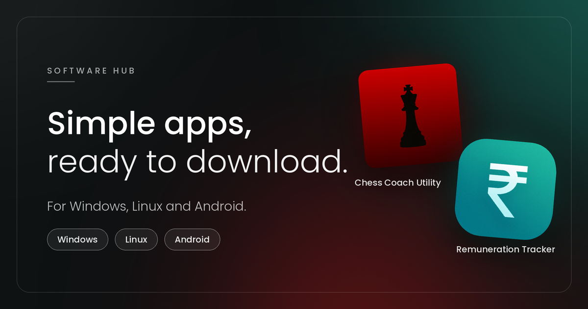

# Software Hub

**Simple, stylish apps for Windows, Linux and Android.**

Small, focused tools published directly by their author. Pick one and download it in a click.

 

 

[About](#-about) · [Features](#-features) · [License](#-license)

---

## About

Software Hub is a website that links to and helps install a collection of small desktop and mobile apps:

- **Chess Coach Utility (CCU)** — Cross-platform desktop tooling for chess coaches, tournament directors, and player development.
- **Remuneration Tracker** — Log your sessions, send tidy invoices and see what you have earned, all in one place.

All downloads go directly to the developer's published releases. No installers wrap the apps, no ads, no tracking — just a clean page with platform-appropriate downloads and install instructions.

## Features

- **Platform detection** — Shows a big download button for your detected operating system (Windows, macOS hint, Ubuntu/Debian, Fedora, Arch, Android).
- **Live version lists** — Reads releases directly from GitHub with a cached fallback, so the site keeps working even offline.
- **Lightbox gallery** — Click screenshots to enlarge; videos autoplay in the lightbox.
- **Changelog extraction** — Parses GitHub release notes into "New / Improved / Fixed" groups.
- **Requirements extraction** — Pulls "## Requirements" bullet lists from release notes.
- **Install guide** — Shows the exact command or steps for your distro on Linux.

## License

- You may download, install and use a copy for your own purposes.
- You may not sell, share, rebrand or reverse engineer the apps without written permission.
- Some apps or features may need a licence or activation code.
